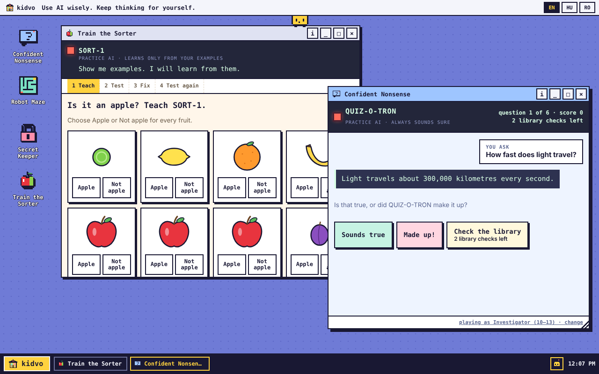

# kidvo

**Use AI wisely. Keep thinking for yourself.**

kidvo is a free, open-source collection of short browser games that help children aged 7 to 13 learn to use AI responsibly without losing their critical thinking. Live at **[kidvo.eu](https://kidvo.eu)**.



## How the games work

Every game has a **practice AI**: a clearly labelled pretend AI (like ORACLE-3000 in Robot Maze) whose answers are written in advance. Some of them are wrong on purpose. Children practise asking, doubting and checking in a place where nothing can go wrong.

- **No real AI, no internet calls.** Every sentence a child sees is in this repository and reviewed.
- **Nothing is collected.** No accounts, ads, tracking or cookies. Progress stays in the browser.
- **Two age bands.** Explorers (7–9) and Investigators (10–13).
- **Three languages to start:** English, Hungarian and Romanian.
- **A printable guide for parents and teachers** comes with every game.

## Games

| Game | For | Teaches |
|---|---|---|
| **Robot Maze** (`apps/maze`) | Explorers and Investigators | AI can be wrong even when it sounds sure; when to ask and when to think |
| **Secret Keeper** (`apps/secret-keeper`) | Explorers and Investigators | Keep personal information away from AI, even when it is friendly |
| **Train the Sorter** (`apps/sorter`) | Explorers and Investigators | AI learns from examples, and one-sided examples make a biased AI |
| **Confident Nonsense** (`apps/nonsense`) | Explorers and Investigators | AI can make things up and still sound sure; check facts |

Plus **Vo**, the desktop's pet, who cheers when a child catches the AI making a mistake.

## Build a game

Anyone can propose a game. Read [CONTRIBUTING.md](CONTRIBUTING.md) for the charter, the merge rules and a five-minute start. AI coding agents: [AGENTS.md](AGENTS.md).

```bash
git clone https://github.com/AlparKacso/kidvo && cd kidvo
npm install
npx playwright install chromium webkit   # browsers for the smoke test
cp -r templates/app apps/my-game
npm run dev        # http://localhost:8080
npm test           # the same checks CI runs
```

## Under the hood

Plain HTML, CSS and JavaScript on GitHub Pages. No framework, no backend; running it costs the domain only. Each game runs in a sandboxed frame with a strict content policy, and CI checks every pull request, then opens every game in a real browser.

## License

Code: [MIT](LICENSE). Texts, art and sound in `apps/`: [CC BY 4.0](LICENSE-CONTENT.md).

Made by Alpár. Questions, or something broken, unsafe or not OK for kids? Write to **hello@kidvo.eu** or [open a report](../../issues/new?template=report.yml); reports are handled first.
